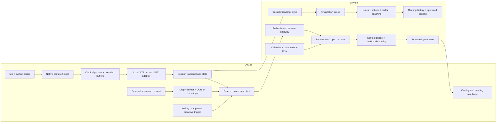

# Independent end-to-end architecture

Everything described as our design is **proposed**. It has not been implemented or benchmarked. These choices reproduce observable capabilities through public interfaces; they do not claim to reveal Cluely’s private implementation.

## 1. System boundaries



Keep continuous audio work, live answers, and post-call jobs in separate lifecycles. A failed summary must not stop audio capture. A failed answer must not destroy a transcript. A disconnected desktop must not cause double billing or duplicate CRM writes.

## 2. Desktop framework decision

| Option | Advantages | Costs/risks | Proposed use |
| --- | --- | --- | --- |
| Electron + native helper | Common cross-platform UI/runtime; documented window/capture APIs; rapid iteration | Chromium footprint, security surface, native bridge maintenance | Default candidate for quickest parity |
| Tauri + native plugins/helper | Rust integration and restricted capabilities; system webview | OS webview differences, capture/window plugin gaps, Rust/platform skills | Strong alternative after capture spike |
| Native Swift/AppKit and Windows client | Direct OS APIs and tailored UI behavior | Two desktop implementations and duplicated release work | Consider if platform behavior forces it |

Tauri supports global-shortcut plugins and packaged sidecars. Neither framework choice itself guarantees capture exclusion or reliable system audio. [Tauri shortcuts](https://v2.tauri.app/plugin/global-shortcut/), [sidecars](https://v2.tauri.app/learn/sidecar-nodejs/)

Do not settle this with preference alone. Build an isolated capture/overlay spike on both target platforms. Choose using CPU/RAM measurements, packaging, multi-monitor behavior, permission recovery, and capture compatibility. If team expertise is mainly TypeScript, Electron plus a narrow native helper is a reasonable initial bias. Isolate capture behind an interface so the UI can be replaced without rewriting the audio pipeline.

## 3. Capture and audio correctness

macOS: ScreenCaptureKit is the supported high-performance capture framework, with system audio and newer microphone support. Use an OS-version capability table; modern capture APIs cannot be assumed on every older system that a competitor’s installer nominally supports. A separate microphone path may be needed for the selected minimum OS. [Apple framework](https://developer.apple.com/documentation/screencapturekit), [Apple microphone additions](https://developer.apple.com/videos/play/wwdc2024/10088/)

Windows: WASAPI loopback captures output from a rendering endpoint, while microphone capture uses its own input path. Shared-mode loopback can work without a hardware “Stereo Mix” device. For our implementation, choose full endpoint capture first and investigate per-process capture for meeting-only audio. [Microsoft loopback](https://learn.microsoft.com/windows/win32/coreaudio/loopback-recording)

Proposed capture helper contract:

```text
AudioFrame {
  session_id, source: mic | system,
  source_epoch, sequence, capture_monotonic_ns,
  sample_rate, sample_count, channels, pcm
}
CaptureStatus {
  source, device_id, permission_state,
  levels, last_frame_age_ms, dropped_frames, error_code
}
```

Capture at native device rates; resample with a proper stateful filter to the STT provider’s accepted rate. Keep source identity and a shared monotonic timeline. Never infer time solely from WebSocket arrival order. Handle device swaps, Bluetooth profile changes, sleep/wake, muted microphones, unplugged headphones, and permissions revoked after installation.

Prefer headphones during early tests because speaker playback can leak into the microphone. Compare acoustic echo cancellation, time-aligned duplicate suppression, and separate-source decoding. Do not delete all simultaneous speech as “echo.” Preserve genuine overlap.

A mic/system split reliably distinguishes local versus remote audio sources, not every remote participant. Multiple remote speakers share the system mix. Diarization IDs are not identities; calendar attendees are candidates, not proof of who spoke. Display unknown speaker labels until evidence or user correction resolves them.

Use bounded queues and a short in-memory recovery buffer. Choose an explicit discard/pause policy under backpressure and show gaps. The default proposal does not persist raw audio; a user-enabled encrypted recovery buffer is a separate feature with a retention policy. Closing a widget and ending capture must be distinct actions, visibly understood by the user.

## 4. Transcription paths

Start with a provider-neutral adapter emitting partial, finalized-segment, end-of-turn, error, and reconnect events. Evaluate AssemblyAI and Deepgram alongside optional local inference. Recall’s SDK may reduce integration effort and add meeting metadata, but has a separate capture fee. Its desktop documentation is an implementation reference, not proof that bare native capture supplies the same metadata. [Recall SDK](https://docs.recall.ai/docs/desktop-sdk)

Local candidates include whisper.cpp for device-native C/C++ inference, faster-whisper for server/NVIDIA workloads, and a streaming wrapper with explicit stability rules. Plain Whisper chunking is not equivalent to a mature streaming recognizer. WhisperStreaming explains LocalAgreement stabilization and overlapping decoding costs; its maintainers point to SimulStreaming as its successor. Benchmark device deployment rather than importing a paper’s latency as our target. [whisper.cpp](https://github.com/ggml-org/whisper.cpp), [faster-whisper](https://github.com/SYSTRAN/faster-whisper), [WhisperStreaming](https://github.com/ufal/whisper_streaming), [SimulStreaming](https://github.com/ufal/SimulStreaming)

Silero VAD is an MIT-licensed candidate for speech activity detection. Use it for silence handling and optional local processing gates, with pre-roll and hangover to avoid cutting words. VAD reduces transmitted samples only if the transport and provider billing policy support that; an open streaming session may still incur duration charges. [Silero](https://github.com/snakers4/silero-vad)

Proposed transcript representation:

```text
TranscriptSegment {
  id, session_id, source_epoch, source,
  start_ms, end_ms, revision,
  text, state: partial | final,
  speaker_id?, language?, confidence?, provider
}
```

Upsert partial revisions by segment ID; do not append each partial as new text. Finalization closes a segment, not necessarily a complete speaker turn. Provider “final” and “speech final” flags can mean different things. Normalize those meanings in the adapter. [Deepgram endpointing and interim results](https://developers.deepgram.com/docs/understand-endpointing-interim-results)

Use sequence/epoch tracking to deduplicate replay after reconnect. Record known loss intervals. Do not pretend failover preserves context, diarization, or exact boundaries without conversion logic. Prewarm local inference, measure thermal behavior, and allow a user-controlled cloud fallback when local real-time throughput fails.

## 5. Screen understanding

Capture when requested by default. Allow optional event/change-driven context updates after evaluating privacy and cost. Full desktop video streaming is unnecessary for many question-answer tasks.

Use selected window/region when possible; crop to relevant content, retain readable text, and encode within model limits. Include capture time, monitor/scale, application/window identity when available, and a user preview. Clear old visual context on window switch unless intentionally retained. Avoid recursively feeding the assistant’s own output back into the prompt.

Text-heavy UI: compare local OCR with direct vision. Apple Vision exposes text recognition on-device. Charts, spatial layout, code formatting, and diagrams may require direct image analysis. OCR is an optional route, not a universal preliminary step: it adds latency and can lose layout. [Apple text recognition](https://developer.apple.com/documentation/vision/vnrecognizetextrequest)

Proposed redaction includes excluded apps/windows, region masks, and sensitive-field detection. Automated redaction can miss secrets; controls should show the user what is sent. Screenshots, documents, and web results are untrusted input. Text in them must not become higher-priority instructions or authorize tool actions.

## 6. Context and memory

Maintain four layers:

| Layer | Purpose | Initial tunable budget |
| --- | --- | --- |
| Current question/turn | Exact latest wording | Always preserve |
| Recent transcript | Local conversation continuity | Last 2–5 minutes, within token cap |
| Structured session state | Decisions, entities, open questions, constraints | Roughly 500–1,500 tokens |
| Retrieved history/documents | Earlier details and company facts | 3–8 relevant passages, within cap |

Numbers are starting hypotheses. Budget in provider tokens, not characters. Use task-specific ceilings; do not pack all files or the whole meeting into every call.

Summaries are lossy caches, not the source of truth. Preserve original transcript spans and link extracted decisions/actions back to them. A live state update records evidence, entity IDs, confidence, and superseded facts. If “$15k” later becomes “$12k,” the context manager must preserve the correction and stop presenting the earlier amount as current.

Proposed knowledge ingestion: validate file type/size → extract in a constrained worker → preserve headings/pages/tables → chunk by semantic structure → embed → index with ownership and freshness metadata. Re-index only changed content. URLs need a refresh schedule, change detection, source provenance, and failure status. Deletion and permission changes must propagate to chunks, caches, and derived artifacts.

Start with Postgres full-text plus pgvector rather than separate memory/vector vendors. Hybrid retrieval combines lexical matches for exact identifiers/names with semantic similarity, then optional reranking. ACL enforcement must happen before returned passages enter a model prompt. pgvector documents important approximate-index filtering/recall behavior; authorization and retrieval recall are different concerns. Benchmark restrictive tenant/team filters and consider exact search or partitioning for small corpora. [pgvector](https://github.com/pgvector/pgvector)

Do not build an elaborate knowledge graph before examples show it adds value. Begin with stable person/company IDs, links between meetings and sources, and evidence-backed facts. Resolve attendees primarily by email, with ambiguous matches reviewed. External profile enrichment is optional, cached, sourced, and independently costed.

## 7. Answer orchestration

For each trigger:

1. Assign request ID, freeze transcript/screen/mode versions, and show immediate pending state.
2. Identify task: suggested reply, explanation, recap, document fact, screen analysis, or coding.
3. Retrieve relevant evidence under tenant/user/team permissions.
4. Build a bounded prompt with clear evidence boundaries and output language.
5. Choose an evaluated small model first where it is adequate; escalate complex reasoning explicitly.
6. Stream a useful short response, followed by optional detail and sources.
7. Cancel stale work when a newer request replaces it; record tokens, timing, and cost.

Model routing must use observed quality/latency curves. A model’s self-reported confidence is not a calibration method. Use task difficulty, retrieval coverage, language, source conflicts, and user preference. Avoid serial small-model-then-large-model retries for every answer; they double costs and delay the answer.

Proposed response contract:

```text
Answer {
  request_id, context_version,
  suggested_reply, optional_details,
  citations: [{source_id, span_or_page, source_version}],
  missing_information, uncertainty_flags,
  generated_at, model_id
}
```

Citations require checking that the referenced source exists and supports the claim. Grounding is more than placing a document name beside generated text. Prefer “I don’t have our approved pricing for that” to an unsupported quotation or commitment. Render markdown/code safely; do not execute generated content in the UI.

Web search should be a task-specific path with its own deadline and budget. Use internal sources for internal product facts. Search fresh external questions when needed, cite actual retrieved sources, and surface delay rather than blocking every ordinary reply behind browsing.

For optional proactive suggestions, use inexpensive detectors, finalized-turn triggers, cooldowns, deduplication, and a relevance threshold. Log rejected triggers too, using metadata where possible, to evaluate missed opportunities. Never invoke a large model at a high fixed frequency simply because audio exists.

## 8. Latency engineering

Measure at least: audio timestamp → first partial; utterance end → committed text; hotkey → first token; hotkey → first useful sentence; utterance end → useful proactive suggestion; session end → notes ready.

An illustrative hotkey budget is 50–200 ms local preparation, 50–250 ms transport/auth, 50–300 ms retrieval, 200–900 ms model first token, and 100–500 ms to a useful sentence. Some stages can overlap. These are targets to test, not observed figures. Network region, image upload, cold start, long context, and tool calls can dominate tails.

Optimize persistent connections, precomputed embeddings, preloaded modes, near-user routing, stable prompt prefixes, shorter outputs, and bounded queues. Prompt caches have minimum sizes, TTLs, writes, and sometimes storage fees; account for misses and changing prefixes. Store time traces without retaining sensitive prompt contents by default. P95 usefulness matters more than the fastest demo token.

## 9. Post-call jobs and history

Session state machine: `idle → starting → active ↔ paused → stopping → finalized`, with explicit failure/recovery states. Transport reconnection is a nested state, not a new meeting by itself. Finalization is idempotent and keyed to transcript version. A resumed meeting creates a new analysis version rather than overwriting reviewed notes silently.

Separate jobs for notes, action extraction, follow-up drafts, and coaching. Each should carry source-span IDs and a schema version. Extract action owner/due date only when supported; “unassigned” and “not specified” are valid values. For long sessions, chunk analysis with overlap and a final reconciliation step; evaluate lost cross-chunk decisions.

Provide editable notes with generated-versus-user-edited provenance. Sharing uses high-entropy revocable tokens and explicit scopes/expiration. Public links should not silently expose the transcript. Export plain text/Markdown/JSON first, adding PDF if users need it. Cross-meeting chat retrieves original material and respects deletion and sharing boundaries.

## 10. Calendar and business integrations

Google: implement OAuth with least-privilege scopes, initial sync, persisted sync tokens, watch-channel renewal, and periodic reconciliation. Push notifications are change signals rather than full event payloads, and delivery is not guaranteed. Handle invalidated tokens and recurrence/cancellation changes. [Google push](https://developers.google.com/workspace/calendar/api/guides/push), [incremental sync](https://developers.google.com/workspace/calendar/api/guides/sync)

Microsoft: calendar-view delta synchronization tracks a defined calendar/date range, with pagination and opaque state links. Combine change notifications with reconciliation and renew subscriptions. Treat multiple calendars, rescheduled recurring instances, and time zones explicitly. [Calendar delta](https://learn.microsoft.com/en-us/graph/delta-query-events), [delta overview](https://learn.microsoft.com/graph/delta-query-overview)

Start with one direct CRM connector rather than immediately paying for a broad unified connector. Use an outbox, idempotency keys, per-account rate limits, retries, and external IDs. Draft writebacks for review initially; later automation can use explicit per-organization policies. Notes must not create duplicate activities after retries or modify unrelated contacts after fuzzy matching.

Pre-call briefs should distinguish attendee-supplied facts, prior-meeting facts, and external research. Display source dates and uncertainty. Search results for a common name do not establish a person’s identity.

## 11. Security, privacy, release operations

If Electron is chosen, enable context isolation and renderer sandboxing, disable Node integration for web content, narrowly expose IPC, validate caller and message schemas, restrict navigation, apply CSP, and keep Electron patched. Imported files and generated markdown are hostile-input boundaries. [Electron security guidance](https://www.electronjs.org/docs/latest/tutorial/security)

Use Keychain/Credential Manager for device credentials, short-lived scoped tokens for provider sessions, server-side secrets for hosted plans, and scoped encrypted OAuth refresh tokens. BYOK secrets stay in the OS vault; provider requests still leave the device when using a cloud model.

Make capture/pause/retention/sharing controls part of the product. Do not record automatically merely because a process looks like a meeting. Recording/processing disclosure and consent requirements depend on deployment; a launch-market legal review remains an external dependency. The architecture should support notices and organization policies without implying that lack of a meeting bot settles those obligations.

Proposed default: no model training, no persisted raw audio/screenshots unless enabled, configurable transcript retention, and explicit exports. Apply deletion to database rows, vector chunks, object storage, share links, local caches, and provider data where applicable; state backup expiry separately. Encryption in transit/at rest is not end-to-end encryption against our service. Fully private inference requires local processing or a separately validated confidential-compute design.

Keep the first backend small: session gateway, Postgres/pgvector, object storage, queue/worker, model/STT adapters, and billing/usage ledger. Split services only for measured scaling/isolation needs. Meter from provider usage plus local operation IDs; reconcile against invoices and reserve quota before costly work. Use signed/notarized installers and signed update manifests, staged rollouts, a recovery version, crash reporting with redaction, and feature flags for capture/model changes.

## 12. Mobile and enterprise completion

Mobile parity initially means in-person recording/voice memos, secure sync, notes, and history. It does not imply unrestricted capture of arbitrary phone calls or other apps’ audio. Verify actual iOS/Android permissions/background behavior before promising that scope.

Enterprise completion adds organization/team membership, SSO/SCIM when needed, audited sharing and writeback policies, data retention/region settings, team knowledge ACLs, prompt/mode versioning, usage reports, connector administration, and evidence-linked coaching. A sales score is not a validated predictor of outcomes; calibrate rubrics against reviewed examples and do not use unsupported voice sentiment as objective performance evidence.
